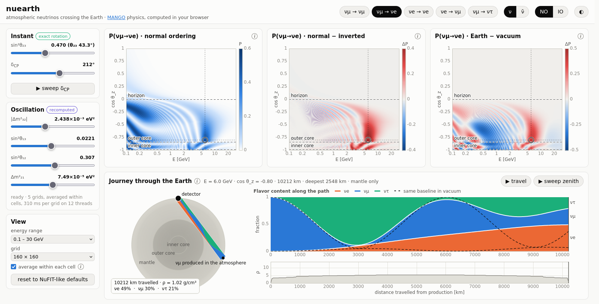

# nuearth: atmospheric neutrino oscillations through the Earth

**Live: <https://pgranger23.github.io/nuearth/>**

An interactive web demo of atmospheric oscillations with Earth matter effects,
inspired by [NuGlass](https://github.com/czczc/nuglass) (C. Zhang, arXiv:2608.25049).
The app is static and runs entirely in the browser. Probabilities come from
**mango-lite** (`web/js/mango-lite.js`), a line-by-line JavaScript port of
[MANGO](https://github.com/pgranger23/mango-osc) (layered PREM, cayley propagator), on a
pool of Web Workers. MANGO itself stays the reference: the port is tested against
MANGO-generated grids to 5e-14. NuGlass only covers constant density (beam and reactor
baselines); this app is about the Earth.



## Run locally

```bash
python3 -m http.server 8060 -d web      # any static server works (ES modules need http, not file://)
# open http://localhost:8060   (from a laptop: ssh -L 8060:localhost:8060 <this host>)
```

To check the port against MANGO:

```bash
source env.sh                           # LCG_110 view (jax, node) + MANGO on PYTHONPATH
python tests/test_engine.py             # server/engine.py (MANGO) reduced basis vs mango.probability_earth
python scripts/make_golden.py && node tests/test_port.mjs   # mango-lite vs MANGO goldens, + timing
```

## Deployment

Each push to `main` runs `node tests/test_port.mjs` in GitHub Actions and, if the port
still agrees with the MANGO goldens, publishes `web/` to GitHub Pages
(`.github/workflows/pages.yml`). Pull requests run the test only. Nothing runs on a
server: every visitor computes on their own machine.

## Layout

* `web/js/mango-lite.js`: the MANGO port (PREM shells, chord geometry, `eigvalsh3`,
  cayley propagator, layer product, path evolution).
* `web/js/compute.js`, `worker.js`: the worker pool, grid cache and cancellation.
* `web/js/physics.js`: the exact θ23/δCP rotation.
* `web/js/main.js`, `oscillogram.js`, `earth.js`, `plot.js`, `colors.js`: UI.
* `server/engine.py`: the same quantities with MANGO (the reference), used to make the
  goldens in `tests/golden/`.
* `.github/workflows/pages.yml`: tests the port, then publishes `web/` to GitHub Pages.
* `docs/design-notes.md`: the engine options considered and the cost of precomputing.

## How it works: the reduced basis

The matter potential `diag(V, 0, 0)` commutes with `O = R23 · diag(1, 1, e^{iδ})`, and
the PDG PMNS matrix factorizes as `U = O · R13 · R12`. So, for **any** density profile,

    S(θ23, δ) = O · S'(θ23 = 0, δ = 0) · O†         (ν̄: S' with anti=True, O with δ → −δ)

The engine computes the 3×3 complex `S'` on an (E, cos θz) grid, and `O` is applied
exactly afterwards. In this basis H is real symmetric, which keeps the port simple and
fast. As a result:

* **Instant:** θ23, δCP, the channel and ν/ν̄ switching.
* **Recomputed** (~30 ms per 160² grid on 12 worker threads; queued work for stale
  parameters is dropped while sliders move): |Δm²32|, θ13, θ12, Δm²21. The Earth is
  fixed: MANGO's PREM, `n_sub=2`, neutrinos produced 15 km up, detector at the surface.
  Each parameter change computes NO and IO grids for the current particle, one vacuum
  grid (in the reduced basis the vacuum ν̄ grid equals the ν one), and prefetches the
  other particle unless the browser reports 4 cores or fewer.

`server/engine.py` reaches into three MANGO internals: `earth.chord_segments`,
`layers.propagate_layers`, and `hamiltonian`/`propagator` for the path view. A small
`amplitude_earth` (or `return_amplitude=True`) in MANGO would remove that coupling.

## Averaging within cells

Below ~1 GeV the oscillation phase changes by more than a grid cell can follow, so one
sample per cell gives moiré (`docs/averaging_before_after.png`). With "average within each
cell" (default) each pixel is the mean of P over its cell, which is close to what a
detector's energy and angle resolution would show.

* **Exact rotation is kept.** P = |Σ K S'|² is bilinear in S', so the cell average only
  needs ⟨S' S'*⟩. Starting from νe or νμ, that is 45 floats per pixel (`averagedGrid` in
  `mango-lite.js`; `channelWeights`/`probAvgAt` in `physics.js`), and θ23/δCP are still
  applied afterwards.
* **Adaptive sampling.** Each cell gets nE × ncz midpoint samples so that the phase moves by
  ≤ 1.5 rad between samples (capped at 24 per axis). Along E this uses the vacuum
  2Δ31 phase. Along cos θz it uses the change of the total path, plus the path moved
  between mantle and core, weighted by the density contrast. The latter jumps like a
  square root at the core-grazing angles and near cos θz = −1.
* **Progressive display.** A one-sample pass appears first (~25 ms per grid), then the
  averages replace it: ~11× the cost on 0.1–30 GeV, ~355 ms per 160² grid on 12
  threads in Firefox. At 1–100 GeV almost every cell needs a single sample.
* **Checks** (`node tests/test_port.mjs`):
  * ⟨P⟩ from averaged products equals the mean of P over the same samples to 2e-16,
    for all channels and random θ23/δCP;
  * one-sample cells equal the products of MANGO's S' (3e-8, float32);
  * against 3× finer sampling, max |ΔP| = 0.04 (99% of cells within 0.02), compared
    with 0.54 for one sample per cell.

Up-going chords with the detector at the surface are palindromic. Since each layer's S'
is complex symmetric, S_earth = QᵀQ (the NuFast-Earth trick). This halves the
propagators: 99 ms per plain 160² grid on one thread. Results still agree with MANGO to
3e-14.

## Validation of the MANGO reference engine (`tests/test_engine.py`)

| check | result |
|---|---|
| S' rotated in the browser vs `mango.probability_earth` with full θ23, δ (random params, NO/IO, ν/ν̄) | max \|ΔP\| = 1.2e-14 |
| path view: S'(x = L) vs grid amplitude; unitarity along the path | 1.5e-14; 3e-14 |
| dS'/d core_scale and dS'/dΔm²31 (autodiff) vs central finite differences | 2e-9, 2e-10 relative |
| PREM layering `n_sub=2` (default) vs `n_sub=8`, 160×160 grid 1–100 GeV | max \|ΔP\| = 5.6e-3 (n_sub=1: 1.8e-2; 3–4: 3.5e-3) |

## JS engine: validation and speed

* **Agreement with MANGO** (`node tests/test_port.mjs`, goldens from
  `scripts/make_golden.py`):
  * grids: max |ΔS'| and max |ΔP| ≤ 5e-14 on 7 cases (NO/IO, ν/ν̄, scaled-density PREM,
    uniform, vacuum, n_sub=4, detector depth); the port keeps those Earth options even
    though the UI fixes PREM;
  * path evolution: ≤ 1e-14.
* **Speed** of one 160×160 grid, single thread: 153 ms in Node 22 and 216 ms in
  Firefox 140 (`web/bench.html`). In the app on 12 workers: ~30 ms per grid, ~60 ms at
  220². One journey trajectory takes ~1 ms on the main thread.

## Views

On a screen at least 1200 px wide and 540 px tall, the three oscillograms and the
journey share exactly one viewport. Picking a point and following the neutrino needs no
scrolling; the slices and the plot explanations sit below the fold. On short screens
(≤ 720 px) the header subtitle and the density strip are hidden. On narrow screens
everything stacks.

* **Three oscillograms side by side** over (log E, cos θz), sharing one selection
  crosshair (click or drag on any of them), with the outer- and inner-core grazing
  directions marked:
  * P for the chosen channel and ordering;
  * P(NO) − P(IO), the mass-ordering signal (toggle ν/ν̄ for the sign flip);
  * P(PREM) − P(vacuum), the matter effect.
* **Slices** P(E) at the chosen direction and P(cos θz) at the chosen energy, each with NO,
  IO and vacuum.
* **Journey through the Earth** (replaces NuGlass's *Flavortube*): a PREM cross-section
  with the chord. The ribbon's three bands are the νe/νμ/ντ fractions along the path,
  with a neutrino you can animate or drag. Beside it, the fractions vs distance (vacuum
  dashed) and ρ(x) along the path. The header line gives E, cos θz, the path length and
  the deepest point.
* Removed after the first review:
  * derivative maps (∂P/∂δCP, ∂P/∂θ23, ∂P/∂|Δm²32|, ∂P/∂ln ρ);
  * the Earth-model controls;
  * the ν vs ν̄ biprobability panel.
* Never built: NuGlass's *Statesphere*, *Phasors*, *Worldline* and 3D surface, which bring
  little through a layered Earth.

## Known limitations and next steps

* An event-rate view (Honda flux × σ_CC × P, νμ/νe CC, up-down asymmetry, NO/IO
  difference) would show what a detector actually sees.
* Tested in Firefox only so far. The workers are ES modules, which need Chrome 80+,
  Firefox 114+ or Safari 15+.
* The averaged pass costs ~20 CPU-seconds for its 5 grids at 0.1–30 GeV: 1.8 s on 12
  threads, several seconds on a 4-core laptop or a phone. The one-sample pass still
  shows up at once.
* NSI or steriles break the reduced-basis factorization: θ23/δ would then go into the
  propagation, and the port would need the complex-Hermitian version.

## License

MIT (see `LICENSE`). `web/js/mango-lite.js` is a port of
[MANGO](https://github.com/pgranger23/mango-osc), also MIT. The PREM density
polynomials are from Dziewonski & Anderson, Phys. Earth Planet. Inter. 25, 297 (1981);
the palindromic-chord speed-up follows NuFast-Earth (Denton & Parke).
